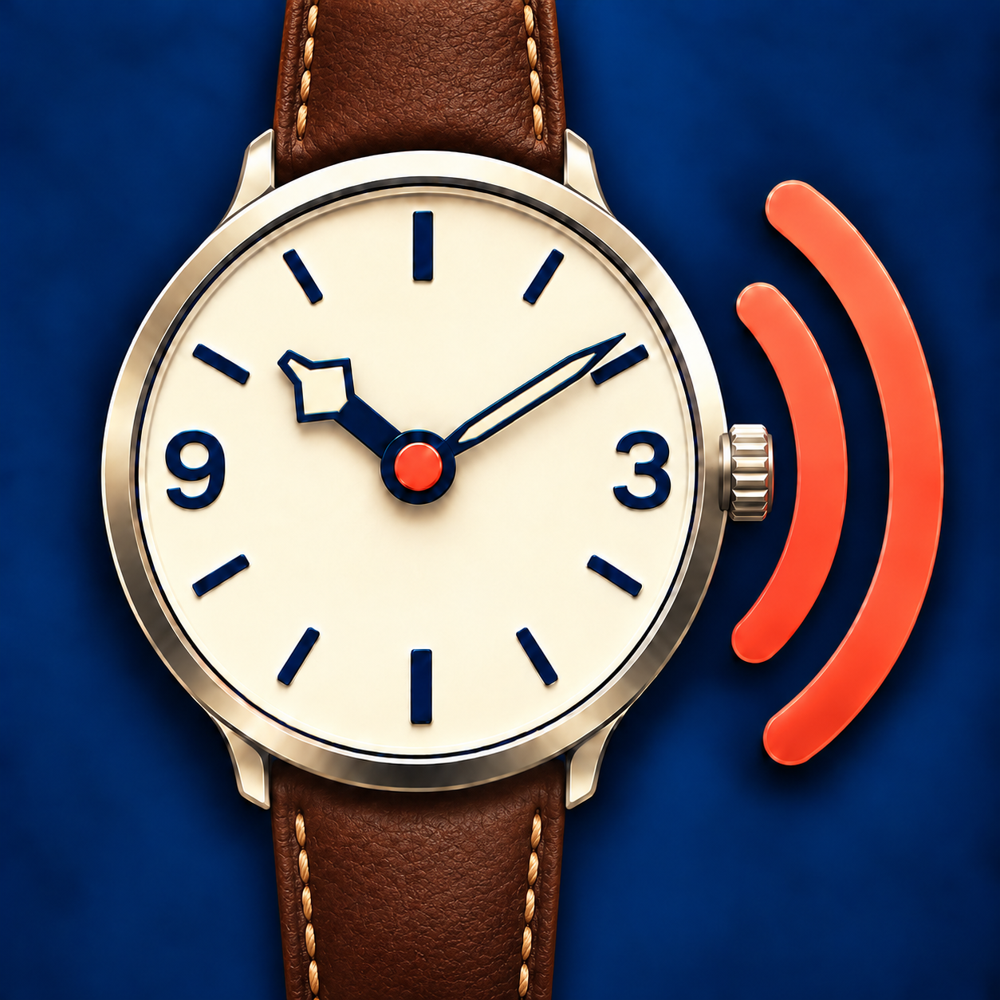
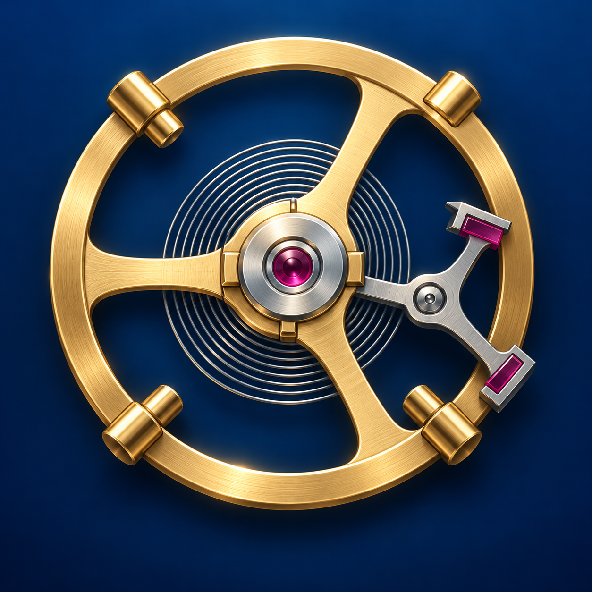
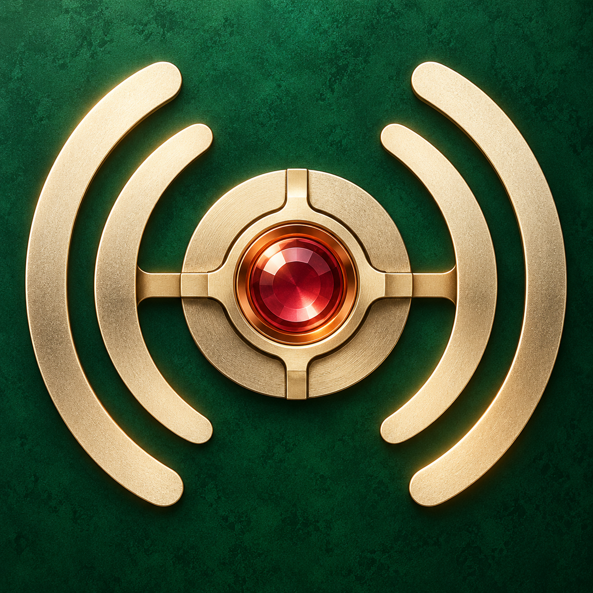
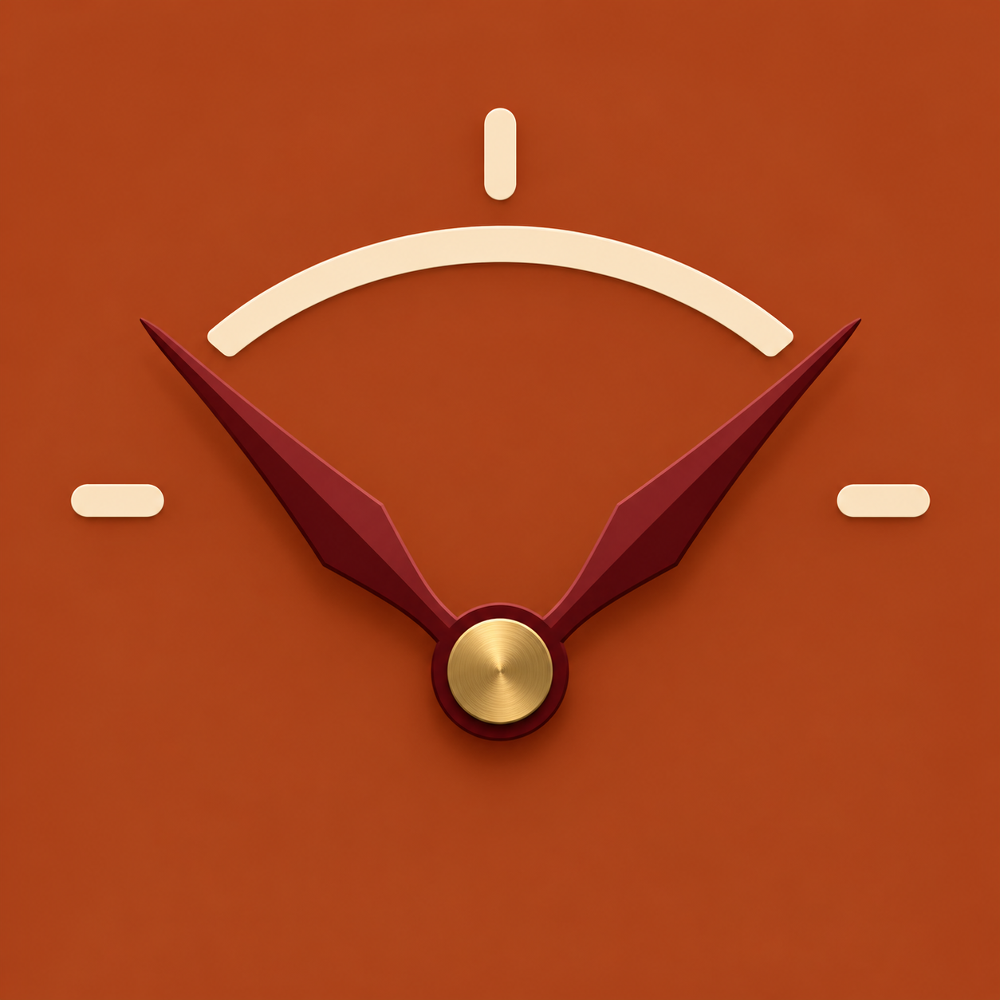

# App icon directions

Five visual concepts for Watch Accuracy Meter. The refined first direction is
now used as the app icon; the other four remain explorations. Concept images
are square 1254 × 1254 PNGs, while the app icon asset is sized to 1024 × 1024.

## 1. Listening dial

Combines the watch face and the app's listening method in one recognizable
symbol. This refinement has two hands, a Tudor-inspired Snowflake hour hand,
Explorer-inspired 3 and 9 numerals, a fluted winding crown at 3 o'clock, and a
stitched brown strap. It is the quickest read, though it risks looking like a
general clock or audio app.

## 2. Balance wheel

Puts mechanical watchmaking at the center and gives the app a more enthusiast
identity. Its moving parts need simplification before use at small sizes.

## 3. Two ticks, one interval

Represents the measurement itself: two ticks and the time between them. It is
the most abstract direction and may need a clearer watch cue at a glance.

## 4. Resonant movement

Joins a movement pivot with paired resonance arcs. It feels distinctive and
crafted, but the sound arcs may initially read as a wireless or broadcast
symbol.

## 5. Oscillating hand

Shows repeated motion and the idea of rate without implying a measuring gauge.
The split hand could read as a timer unless the watch context is strengthened.

## Apple HIG fit

These directions follow Apple's current guidance to use one simple central
idea, keep important shapes centered and legible at small sizes, avoid
unnecessary words and fine detail, and provide square artwork for iOS to mask.
The generated concepts are illustrative drafts rather than final layered icon
files. A selected direction should be simplified at small scale and prepared
for the iOS 1024 × 1024 icon canvas and supported appearance variants.

Source: [Apple Human Interface Guidelines — App icons](https://developer.apple.com/design/human-interface-guidelines/app-icons/).
