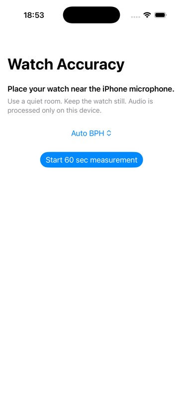
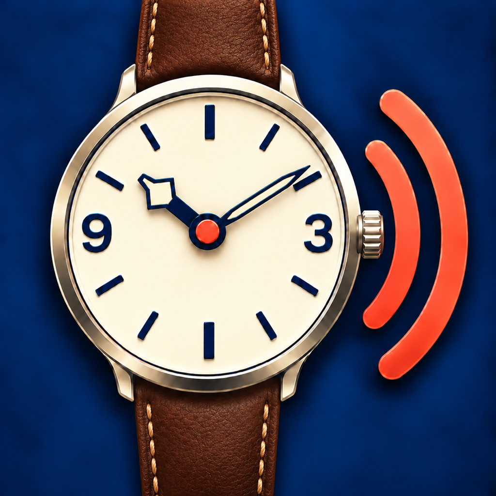

# Watch Accuracy Meter for iOS

Watch Accuracy Meter is a native iOS app that estimates whether a mechanical watch is running fast or slow by listening to its ticks through the iPhone microphone.

The app is intentionally local and focused: no backend, login, cloud sync, watch profiles, amplitude, or professional timegrapher claims. Raw microphone audio stays on the device unless the user explicitly exports a debug capture.

## Screenshots

### Measurement screen



### Current app icon



[About this project](ABOUT.md)

## Current MVP

- Swift 6, SwiftUI, and AVFoundation
- iOS 17 or later
- 60-second foreground microphone capture
- Built-in iPhone microphone preference and unsupported-route rejection
- Auto BPH detection with ambiguity and harmonic checks
- Manual BPH selection when the beat rate is already known
- On-device transient detection and robust beat-grid fitting
- High, Medium, or Low signal-quality result
- Early retry guidance for quiet input or route changes
- Live indication that microphone samples are being received
- Optional local debug export containing raw audio, diagnostics, and provisional
  tick-candidate metadata

Supported beat rates:

- 18,000 bph
- 19,800 bph
- 21,600 bph
- 25,200 bph
- 28,800 bph
- 36,000 bph

Auto mode evaluates every supported beat rate. It returns a confident result only when the winning beat grid is sufficiently stronger than the alternatives. Ambiguous audio is reported as Low quality, and its `sec/day` estimate is not presented as usable.

## How It Works

```text
Built-in iPhone microphone
-> raw mono Float32 samples
-> rumble suppression and transient emphasis
-> locally normalized envelope
-> adaptive threshold sweep
-> tick candidate detection
-> duplicate/resonance suppression
-> beat-grid assignment and robust regression
-> one-beat and alternating tick/tock spectral evidence
-> competing-BPH and harmonic checks
-> seconds/day estimate with confidence gating
```

Capture uses `AVAudioSession` with `.record` and `.measurement`. Voice processing and noise-cancel modes are intentionally avoided because they can remove short mechanical tick transients. Noise handling happens in the DSP while the original samples remain available for local analysis and optional export.

Medium and High results require:

- sufficient tick recall across the full recording;
- successful analysis windows across the recording;
- stable periodicity and beat-grid coverage;
- acceptable outlier levels;
- an unambiguous BPH match.

## Build Requirements

- macOS with Xcode 16 or later
- iOS 17+ SDK
- XcodeGen when changing `project.yml`, adding source files, or adding test resources
- A physical iPhone for microphone validation

The generated `WatchAccuracyMeter.xcodeproj` is tracked in git, so it can be opened directly for normal development.

## Run the App

1. Open `WatchAccuracyMeter.xcodeproj`.
2. Select the `WatchAccuracyMeter` scheme.
3. Select an iPhone Simulator for build and UI checks, or a connected iPhone for microphone testing.
4. For a physical device, select your Apple development team under Signing & Capabilities if Xcode requests one.
5. Build and run.

The project does not pin an Apple development team. Select your team in Xcode's Signing & Capabilities when building to a physical iPhone.

After changing project structure or resources, regenerate the project:

```sh
xcodegen generate
```

If a physical device reports that its developer disk image cannot be mounted, make sure Xcode supports the iOS version installed on the phone, unlock and trust the phone, reconnect it, and let Xcode finish preparing the device.

## Measuring a Watch

1. Use a quiet room and keep the phone and watch still.
2. Place the watch caseback directly against or very close to the bottom iPhone microphone.
3. Keep `Auto BPH` selected, or choose the watch's known beat rate manually.
4. Start the 60-second measurement.
5. Confirm that the app shows microphone samples being received.
6. Repeat Medium results and treat Low results as a retry, not a rate measurement.

Bluetooth and headset inputs are rejected because their bandwidth and processing are unsuitable for reliable mechanical tick capture. Older iPhones may still apply hardware automatic level control that iOS does not expose or disable.

## Tests

Run the simulator unit and regression suite with Xcode or:

```sh
xcodebuild test \
  -project WatchAccuracyMeter.xcodeproj \
  -scheme WatchAccuracyMeter \
  -destination 'platform=iOS Simulator,name=iPhone 17'
```

The suite covers synthetic fast/slow watches, missed ticks, quiet signals, white noise, handling rumble, gain changes, resonance duplicates, impulse and burst noise, wrong BPH rejection, Auto BPH selection, capture state, export metadata, and cancellation behavior.

Sanitized real-device fixtures are stored in `Tests/WatchAccuracyMeterTests/Fixtures/`:

- King Seiko at 28,800 bph
- iPhone bottom-microphone capture at 28,800 bph
- Tudor GMT at 28,800 bph

These fixtures protect known recognition behavior, but they do not prove 90%
real-world accuracy. The benchmark gate is eligible only with at least 100
labeled windows from 20 unique captures, five watches, and two devices. Exact
`sec/day` is not asserted for real fixtures without a trusted reference
timegrapher measurement.

Replay private full captures without adding them to git:

```sh
Tools/RecognitionBenchmark/run-recognition-benchmark /path/to/manifest.json > /tmp/recognition-report.json
```

See `Tools/RecognitionBenchmark/README.md` for the private manifest format. The
JSON report includes every window outcome and explicitly distinguishes an
unpopulated gate from a passing result.

Simulator tests validate compilation, UI wiring, DSP behavior, and fixture regressions. Microphone routing and recognition quality must still be tested on a physical iPhone.

## Debug Exports

After a measurement, the debug export creates a local folder containing:

- `capture.wav`: raw mono captured samples;
- `diagnostics.json`: selected/detected BPH, rate, quality, coverage, periodicity, threshold, RMS, peak, clipping, SNR, route, sample rate, and window results.
- `candidates.json`: bounded provisional tick/noise events for offline review and
  future Core ML candidate-verifier training.

Exports are created only after an explicit user action and can be shared for regression debugging. Do not commit private full recordings. Only small, sanitized, approved WAV trims belong under the fixture directory.

## Repository Layout

```text
Sources/WatchAccuracyMeter/
  AudioCapture.swift
  AudioCaptureExporter.swift
  AudioWatchMeter.swift
  CandidateReview.swift
  ContentView.swift
  MeasurementViewModel.swift
  TickCandidateFeatures.swift
  WatchAccuracyMeterApp.swift
  WatchDSP.swift
Tests/WatchAccuracyMeterTests/
  CandidateReviewTests.swift
  Fixtures/
  TickCandidateFeatureTests.swift
  WatchDSPTests.swift
Docs/
  MVP_Technical_Document.md
  ON_DEVICE_ML_RESEARCH.md
  ROADMAP.md
  VALIDATION_PLAN.md
Tools/RecognitionBenchmark/
Tools/CandidateReview/
Tools/TickCandidateMLExperiment/
project.yml
WatchAccuracyMeter.xcodeproj/
```

## Experimental on-device ML

An offline Create ML experiment evaluates whether transient-shape features can
separate provisional ticks from noise while holding out complete watches. It
also compares full DSP-only and model-assisted Auto-BPH outcomes. It can produce
a small Core ML model for technical validation, but generated models remain
ignored and are not used by the app.

```sh
Tools/TickCandidateMLExperiment/run-tick-candidate-ml-experiment \
  /path/to/manifest.json \
  --model-type logistic \
  --model-output /tmp/tick-candidate.mlmodel \
  > /tmp/tick-candidate-report.json
```

See `Tools/TickCandidateMLExperiment/README.md` and
`Docs/ON_DEVICE_ML_RESEARCH.md` for the current evidence and shipping gates.

Manually review a balanced candidate sample without uploading audio:

```sh
Tools/CandidateReview/run-candidate-review \
  /path/to/capture.wav \
  28800 \
  /tmp/watch-review
```

Open `/tmp/watch-review/review.html`, classify candidates, and export the label
JSON. The private review package embeds the source audio and must not be added
to git. See `Tools/CandidateReview/README.md` for the complete workflow.

## Product Limits

Watch Accuracy Meter is a hobbyist phone-based estimate, not a replacement for a Witschi, Weishi, or professional watchmaker diagnosis. The MVP does not measure amplitude or beat error, and its `sec/day` output should be confirmed with repeated measurements under controlled conditions.
